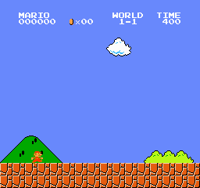
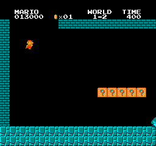

# mario_dqn_cpp — 依存ゼロC++で作るDQN（→ 本物のNESでスーパーマリオ）

*日本語 | [English](README.en.md)*

**外部ライブラリを使わず（C++標準ライブラリ・CPUのみ）自作の自動微分エンジンから DQN
（Deep Q-Network）** を組み上げ、最終的に **本物のNESエミュレータでスーパーマリオをプレイさせる**
ことを目指すプロジェクト。DQNは [othello_alphazero_cpp](https://github.com/yomei-o/othello_alphazero_cpp)
の AlphaZero（方策＋探索）と対になる **価値ベース・オフポリシー** の強化学習。

autograd は [mini-yolov5-cpp](https://github.com/yomei-o/mini-yolov5-cpp) の自作エンジンを流用。

> **中断→再開する人へ**：現在地と次の一手は [`RESUME.md`](RESUME.md) にまとめてあります。

## 🎮 最新プレー：DQNがスーパーマリオ 1-1 をスタート地点から自力クリア



自作autograd＋DQN（CPUのみ）が、RAM特徴量だけを見て **1-1 をスタートからフラッグポールまで通しプレイ**（決定的に再現される実プレイの録画。約2倍速）。得点優先の報酬シェーピングで**敵を踏み・コイン/得点を稼ぎながら**ゴールする。学習・録画の仕組みは [`RESUME.md`](RESUME.md) 参照。GIFは `ffmpeg` で `web/run.bin`（録画）から生成（[`tools/make_gif.sh`](tools/make_gif.sh)）。

## 🎬 各面のクリア動画一覧

**[docs/CLEARS.md](docs/CLEARS.md)**：1 つの学習ネットで 1-1 と 1-2 をクリアする動画と、1-1（キノコあり）・1-2・1-4（城）の探索による手本走行。
全面共通の環境 `smb_env`（どの面でも同じ盤面観測・同じ報酬）と、複数の面をまとめて学習する `smb_train` で作ったもの。

## ⚡ GPU 学習（DQfD）：greedy 方策がスタートから 1-1 を自力クリア


上の GIF は録画の再生ではなく、**学習したネットの greedy 推論そのもの**（412 手でポールをつかみ、旗が降りて城へ）。
ネットは [`warmstarts/dqfd_gpu_clear_1-1_3act_hid512.bin`](warmstarts/)（3行動・隠れ512）。MSVC/Windows と gcc/Linux の
両方で、同じ 412 手でクリアすることを確認済み。

仕組み（[`mario_gpu.cpp`](mario_gpu.cpp)）:

1. **きれいなデモを探索で作る**（`mario_gpu searchdemo`）: 基本は「走る」、障害で詰まったらセーブステートから
   「何ステップ前に踏み切り、何ステップ押し続けるか」を総当たりする。さらに **踏み切り ±1・押す長さ ±1 でも成功する余裕のある
   タイミング**を選ぶ。ランダム探索で拾ったクリア（ジャンプや小ジャンプが散らばっている）は、ネットが観測から再現できない
   操作列だった。これが以前の BC が 900〜2370 で止まった原因。
2. **DQfD**: Double-DQN の TD 損失に、デモ状態ではデモの行動を他より margin 以上高くする損失を加える。
   事前学習で greedy がデモをなぞるようにしておき、強化学習でデモから外れた状態からの立て直しを覚えさせる。
3. **Ape-X 型の並列化**: NES エミュは 1 プロセスに 1 つしか持てないので、ε の異なる **CPU アクターを複数プロセス**で走らせる
   （半分のエピソードはデモ上のチェックポイントから開始）。**ラーナーは 1 つで、GPU（CUDA + cuBLAS）**上で大きなバッチを学習する。
   CPU 版ラーナーも同じ計算で持っていて、`mario_gpu parity` で GPU と一致することを確認できる（3090 / T4 で重みの差は 1e-5 未満）。

```sh
cmake -S . -B build -DCMAKE_BUILD_TYPE=Release -DCMAKE_CUDA_ARCHITECTURES=86   # nvcc が無ければ CPU ラーナーで動く
cmake --build build --target mario_gpu
./build/mario_gpu searchdemo "$ROM" demo.bin                  # 走る+ジャンプだけのクリアデモ（数分〜20分）
./build/mario_gpu train "$ROM" demo.bin 16 40                 # アクター16本、最長40分。greedy でクリアした時点で終了
./build/mario_gpu record "$ROM" mario_gpu_clear.bin run.bin   # → tools/make_gif.sh run.bin out.gif
```

実測: RTX 3090 + アクター16本（約1100 env step/s）で **5.2 分**でクリア。Kaggle（T4、4 vCPU）では
[kaggle_server_cpp](https://github.com/yomei-o/kaggle_server_cpp) 経由で [`kaggle/train_gpu.sh`](kaggle/train_gpu.sh) を
`/job` として投げる。ただし Kaggle はアクターが 3 本しか置けず、エミュも 64 step/s/コアと遅いので、
進みはおよそ 1/6 になる。律速は GPU ではなくエミュレータ。Kaggle で学習したネット
（[`warmstarts/dqfd_kaggle_t4_clear_1-1_3act_wall_hid512.bin`](warmstarts/)）も greedy でクリアする（24.8 分、427 手）。
止まる原因の切り分けには `mario_gpu diagnose ROM net.bin [step]`（報酬 / 観測 / 学習のどれが原因かを判定）。

## 🕹️ ブラウザでライブプレイ（WASM）

NES(LaiNES)＋DQN推論を**丸ごとWebAssembly化**。ブラウザ上で「クリア走行の再生」と
「学習ネットのライブ推論」を実行できる。ROMは各自がファイル選択で読み込み（**送信されない**）。

- **[▶ 1-1 デモ: yomei-o.github.io/mario_dqn_cpp/mario-dqn](https://yomei-o.github.io/mario_dqn_cpp/mario-dqn/)** — スタート→ポール到達の通しクリア＋ライブ推論。
- **[▶ 1-2 デモ: yomei-o.github.io/mario_dqn_cpp/mario-dqn-1-2](https://yomei-o.github.io/mario_dqn_cpp/mario-dqn-1-2/)** — 1-1クリア→1-2遷移後、学習エージェント（NOOP=待つ行動つき）が中盤の「穴＋カメ」を待って突破（x≈978、ゴールは学習途上）。
- **[▶ 1-3 デモ](https://yomei-o.github.io/mario_dqn_cpp/mario-dqn-1-3/)** — **RAMレベルワープ**で直接開始（1-2クリア不要）。学習エージェントが空中プラットフォーム地帯 x≈627 まで。
- **[▶ 1-4 デモ](https://yomei-o.github.io/mario_dqn_cpp/mario-dqn-1-4/)** — 城面（斧クリア）にワープ開始。学習エージェントが序盤 x≈302 まで。

> 1-2〜1-4 の主目的は **面ごとの枠組み（env・報酬・ワープ開始・学習・WASM）を再利用可能なテンプレとして用意する**こと。
> 各面の“完全クリア”は伸びしろとして開放（`train_common.hpp` / `mario_shared.h` に相乗り、`NET=... build_wasmXX.sh` で同URL差し替え）。

## 🚇 World 1-2 に挑戦中（Phase 5）



1-2は地下面で、ゴールに**土管へ入る**必要があり1-1とは別物。まずは**途中まで**進むプレー
（上のGIFは探索方策で 1-2 序盤〜中盤 x≈1202 まで進んだ録画）。面固有の要素（開始位置・
クリア判定・**土管進入ボーナスを別立てした報酬**）を1-1と分離しつつ、観測/行動/エミュ駆動の
**共通コアは共有**する設計（`mario_shared.h` / `mario12.*` / `train12.cpp`）。

1-2には「**穴の向こうに歩くカメ**を待って飛ぶ」タイミング難所があり、右バイアスのままでは超えられない。
そこで1-2の行動集合に **NOOP（待つ）** を足し、**進行はラチェット報酬・待ちは無罰**に再設計すると、
学習エージェントが *実際に待ってから飛ぶ* 挙動を獲得（1-1ネットからwarm-start、x≈978まで）。
出口土管/旗の到達（＝完全クリア）はまだで、探索でクリアを1本捕獲→BCが次の手（[`RESUME.md`](RESUME.md)）。

## ロードマップ

| Phase | 内容 | 状態 |
|------|------|------|
| **1** | **CartPole で DQN コアを実証**（リプレイ・ターゲットネット・Double DQN・ε-greedy・勾配クリップ・Adam） | ✅ 完了 |
| **2** | **LaiNES**（C++ NESエミュ）を組み込み、ヘッドレスな `step/観測/報酬/done` API を実装 | ✅ 完了 |
| **3** | DQN × スーパーマリオ（**RAM特徴量**：マリオのx/y・速度・敵）。**1-1をスタートから通しクリア** | ✅ 1-1クリア |
| **4** | NES＋DQNを **WASM(Emscripten)** 化し、ブラウザでライブプレイ | ✅ 完了（[ライブデモ](https://yomei-o.github.io/mario_dqn_cpp/mario-dqn/)） |
| **5** | **他の面へ（World 1-2〜）**。面ごとに開始・クリア判定・報酬を分離し、共通コアは共有 | 🚧 進行中 |

> **設計判断**：CPU＋自作autogradで「生ピクセルから本物マリオを1面クリア」は非現実的（Atari DQNは
> 当時GPUで数日）。そこで環境は**本物のNESエミュ**、状態は**RAM特徴量**（本物のRAMを読む）にして
> “本物マリオが現実的な時間で上達する”を両立する。

## Phase 1（このリポジトリの現状）

CartPole-v1（棒立て）を DQN で解く最小実装。**同じエージェントをそのままマリオに接続**するための土台。

```
autograd.h/.cpp   自作autograd（mini-yolov5から流用）＋ Huber loss を追加
cartpole.h        CartPole-v1 環境（Gym準拠の物理）
qnet.h            QネットMLP ＋ Adam ＋ ターゲットネット複製
replay.h          経験リプレイバッファ（リング）
main.cpp          学習ループ（Double DQN・ε減衰・勾配クリップ・最良ネット保存・評価）
```

### ビルド & 実行

```powershell
cmake -S . -B build -G "Visual Studio 17 2022" -A x64
cmake --build build --config Release
build/Release/dqn.exe        # CartPole を学習し、貪欲方策の評価を表示
```

Linux/macなら `cmake -S . -B build && cmake --build build`。依存はコンパイラのみ。

### DQNの要点（学習ポイント）

- **経験リプレイ**：遷移 `(s, a, r, s', done)` を貯めてランダムにミニバッチ学習（相関を断つ）
- **ターゲットネット**：TD目標の計算に固定コピーを使い発散を防ぐ（AlphaZeroで作った `copy_from` を流用）
- **Double DQN**：次手の選択はオンライン網、評価はターゲット網（過大評価バイアス低減）
- **TD損失**：取った行動のQだけを `r + γ·maxQ'` に近づける（Huber損失）
- **ε-greedy**：探索率を 1.0→0.05 に減衰
- **安定化**：勾配クリップ（global norm）＋ Adam ＋ 最良ネットのチェックポイント

## Phase 2（ヘッドレスNES）— 完了

`third_party/laines/` に **LaiNES**（BSD-2）のコアをvendorし、**SDL/音源/GUIを剥がして
ヘッドレス化**（`GUI::new_frame`＝フレームバッファ取得、`GUI::get_joypad_state`＝入力注入、
APUはスタブ）。`nes.h/.cpp` がWASM向けのフレーム駆動APIを提供:

```cpp
nes::load_file(path); nes::load_bytes(ptr,n);   // ROM読み込み（ディスク/メモリ）
nes::set_buttons(0, nes::RIGHT);                 // 入力
nes::step_frame();                               // 1フレーム進行
nes::pixels();  nes::ram(0x006D);                // 256x240描画 / RAM直読み
```

- **MSVC/Visual Studioでビルド可能**（LaiNESのGNU拡張 `case a ... b:` を if/else に書き換え済み。
  MinGW不要＝アンチウイルス誤検知を回避）。clang/g++/emcc でも同一コードが通る。
- `nes_test` で **本物のSMBが起動し、RIGHT入力でマリオが前進**（RAMのx位置が増加）を検証済み。

```powershell
cmake --build build --config Release --target nes_test
build/Release/nes_test.exe "Super Mario Bros (JU) (PRG 0).nes"
```

## 結果をブラウザで見る 🍄

学習済みエージェントの1-1プレイを**録画→ブラウザ再生**できる（`web/`）。

```powershell
# 1) greedyプレイを録画（web/run.bin を生成。frame/agent-step の RGB列）
build/Release/mario_dqn.exe record "Super Mario Bros (JU) (PRG 0).nes" mario_best.bin web/run.bin

# 2) 簡易HTTPサーバを起動（どちらか）
python web/serve.py           # Python版 -> http://localhost:8000
build/Release/server.exe      # cpp-httplib版(単一ヘッダMIT) -> http://localhost:8080

# 3) ブラウザで開くと canvas でプレイが再生される
```

`web/index.html` が `run.bin`（先頭に `MRUN`+nframes+w+h、以降 w*h*3 のRGBフレーム列）を
fetchして canvas に再生。※現状は学習途上なので、greedyだと最初のクリボー(x=312)で力尽きる
様子が見える。学習を収束させれば先まで進む録画になる（[`RESUME.md`](RESUME.md)）。

このネイティブ録画→再生は前段で、**Phase 4 は完了済み**：NES+DQNを丸ごとWASM化し
[ブラウザ内でエミュ+推論をライブ実行](https://yomei-o.github.io/mario_dqn_cpp/mario-dqn/)する（上の「ブラウザでライブプレイ」参照）。

## スーパーマリオについて（Phase 3以降）

- 環境は **本物のNESエミュレータ（LaiNES）** を組み込む（`gym-super-mario-bros` の中核と同じ系統）
- **ROMは著作権物**。各自が正規に用意すること（このリポジトリのコードにROMは含めない）
- 報酬は `Δ(マリオのx位置) − 時間ペナルティ − 死亡ペナルティ + ゴールボーナス`

## シリーズ

C++/CPUだけでAIを一から作るシリーズ。関連：
[mini-yolov5-cpp](https://github.com/yomei-o/mini-yolov5-cpp) /
[othello_alphazero_cpp](https://github.com/yomei-o/othello_alphazero_cpp) /
[nanoGPT-cpp](https://github.com/yomei-o/nanoGPT-cpp) /
[nanochat-cpp](https://github.com/yomei-o/nanochat-cpp) /
[lecun1989-cpp](https://github.com/yomei-o/lecun1989-cpp)
