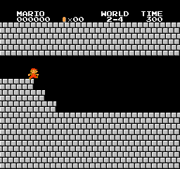
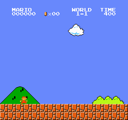
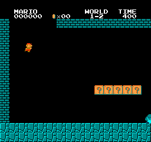
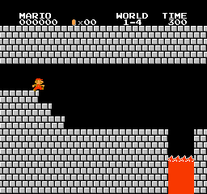
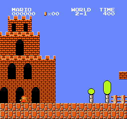
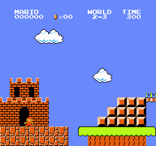
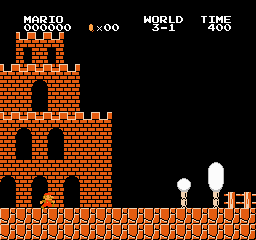
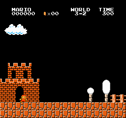
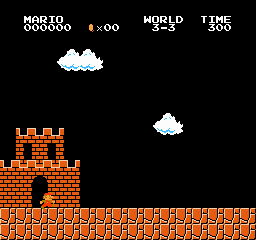
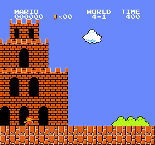

# 各面のクリア動画

*[README に戻る](../README.md)*

動画は 2 種類あります。混同しないよう、それぞれに印を付けています。

- **🧠 学習ネット**: 学習したネットの greedy 推論そのもの。ネットが観測を見て、その場で行動を選んでいます。
- **🔍 手本（探索デモ）**: セーブステート探索で見つけたクリア走行（`smb_train searchdemo`）。ネットの学習に使う手本で、ネットのプレーではありません。

どの動画もエミュレータが決定的なので、同じネット・同じ手本からは毎回まったく同じ走りが再現されます。録画は約 2 倍速の GIF です。

| 面 | 🧠 学習ネット（9 面で学習した 1 つの重み） | 🔍 手本（探索デモ） |
|---|---|---|
| 1-1 | ✅ クリア | ✅ クリア（途中でキノコを取る） |
| 1-2 | ✗（x≈1938）※3 面学習のネットではクリア | ✅ クリア |
| 1-3 | ✗（x≈419、学習に使っていない面） | ✗（45 分の探索で見つからず：動くリフト＋パタパタ） |
| 1-4 | ✅ クリア | ✅ クリア |
| 2-1 | ✗（x≈471、学習に使っていない面） | ✅ クリア |
| 2-2 | — | ✗（45 分で見つからず：水中面） |
| 2-3 | ✗（x≈2017） | ✅ クリア（キノコを取る） |
| 2-4 | ✅ クリア（城） | ✅ クリア（城） |
| 3-1 | ✗（x≈1242） | ✅ クリア（キノコを取る） |
| 3-2 | ✗（x≈3330、ゴール直前） | ✅ クリア |
| 3-3 | ✗（x≈461、学習に使っていない面） | ✅ クリア |
| 3-4 | ✗（x≈1666） | ✅ クリア（城） |
| 4-1 | ✗（x≈1937） | ✅ クリア |
| 4-2 | ✗（x≈312、学習に使っていない面） | ✗（45 分で見つからず） |
| 4-3 / 4-4 | — | ✗（45 分で見つからず） |

---

## 🧠 学習ネット：9 面で学習した 1 つのネット（1-1・1-4・2-4 をクリア）

1-1・1-2・1-4・2-3・2-4・3-1・3-2・3-4・4-1 の 9 面で同時に学習した 1 つのネット（MLP）。評価用の移動平均（EMA）の重みで、
**1-1（449 手）・1-4（288 手）・2-4（282 手、城）** を greedy でクリアします。3-2 はゴール直前（x≈3330）まで行きます。
学習に使っていない 2-1・3-3・1-3・4-2 は序盤で止まります。
ネット: [`warmstarts/smb_mlp9_clear_1-1_1-4_2-4.bin`](../warmstarts/)（RTX 3090、学習開始から約 41 分の時点の EMA。途中から CPU を半分に絞った）。

### 2-4（282 手、城。ファイアバーを抜け、橋の上でクッパを跳び越えて斧へ）



---

## 🧠 学習ネット（前回、3 面で学習）：1 つのネットで 1-1・1-2・1-4 をクリア

1-1・1-2・1-4 の 3 面で同時に学習した 1 つのネット（MLP、全面共通の盤面観測）。同じ重みで 3 面とも、スタートからゴールまで greedy でクリアします。
ネット: [`warmstarts/smb_mlp_clear_1-1_1-2_1-4.bin`](../warmstarts/)（RTX 3090、アクター 16 本、学習開始から約 32 分の時点）。
学習に使っていない 1-3（x≈391）と 2-1（x≈832）はまだ序盤で止まります。また評価のたびにクリアできる面の数が 0〜3 で揺れるので、3 面ともクリアできた時点の重みを保存しています。

### 1-1（370 手）



### 1-2（494 手。地下を抜け、出口の土管から地上へ出て旗をつかむ）



### 1-4（281 手、城。ファイアバーをくぐり、クッパを越えて斧へ）



```sh
./build/smb_train eval   "$ROM" warmstarts/smb_mlp_clear_1-1_1-2_1-4.bin 1-1,1-2,1-4
./build/smb_train record "$ROM" warmstarts/smb_mlp_clear_1-1_1-2_1-4.bin 1-4 run.bin   # → tools/make_gif.sh run.bin out.gif
```

### 参考：1-1 専用ネット（前回）

1-1 だけを学習した 3 行動のネット（`mario_gpu`）。404 手でクリア。


---

## 🔍 手本（探索デモ）

基本は「走る」。詰まったところでだけ、ジャンプ・待つ・戻る・叩くといった手を、セーブステートから総当たりして選びます。
キノコ入りの ?ブロック（タイル ID C1）が近くにあれば、戻ってでも叩いてキノコを取りに行きます。

### 1-1（629 手、キノコを取る）

途中で戻ってキノコ入りの ?ブロックを叩き、大きくなります。その後クリボーに当たって小さく戻り、そのまま旗まで行きます。


### 1-2（617 手）


### 1-4（330 手、城）

ファイアバーをくぐり、最後はクッパを跳び越えて斧に届きます（「THANK YOU MARIO!」まで）。


### 2-1（517 手）



### 2-3（474 手、飛んでくるプクプクの橋。キノコを取る）



### 2-4（314 手、城）


### 3-1（625 手、キノコを取る）



### 3-2（474 手）



### 3-3（312 手）



### 3-4（294 手、城）


### 4-1（533 手、ジュゲムの面）



```sh
./build/smb_train searchdemo "$ROM" 1-4 demo.bin
./build/smb_train recorddemo "$ROM" 1-4 demo.bin run.bin
```
